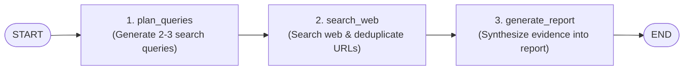

# Beginner-Friendly Autonomous Research Assistant

A clean, understandable, and educational AI Research Assistant built with **LangGraph**, **FastAPI**, **Tavily**, and **SQLite**.

This project is designed specifically to help developers learn the core fundamentals of **LangGraph** by building a working, end-to-end agentic workflow without unnecessary production complexity.

---

## 1. What Does This Project Do?

Given a research question (e.g., *"What are the practical applications of AI agents?"*), the assistant:
1. **Plans Search Queries**: Uses an LLM to decompose the question into 2–3 precise web queries.
2. **Searches the Web**: Calls the Tavily Search API, gathers snippets, and deduplicates URLs.
3. **Generates a Report**: Synthesizes the retrieved evidence into a structured markdown report with key findings, source citations, and acknowledged limitations.
4. **Persists History**: Stores the completed research report and queries in a local SQLite database.

All interactions are exposed through a simple FastAPI backend with interactive Swagger documentation.

---

## 2. Core Concepts: Understanding LangGraph

If you are new to LangGraph, here is the mental model for how every component works:



### Key Terms Explained

* **`StateGraph` (`research_assistant/graph.py`)**:
  Think of `StateGraph` as the blueprint of your agent. You give it a State definition (`ResearchState`), add your worker functions (`nodes`), and connect them in order (`edges`).

* **State Schema (`research_assistant/state.py`)**:
  In LangGraph, the **State** is a shared dictionary (`TypedDict`) passed from node to node like a relay baton:
  ```python
  class ResearchState(TypedDict):
      question: str              # User's input question
      search_queries: list[str]  # Generated queries
      search_results: list[dict] # Gathered web pages
      final_report: str          # Final synthesized report
  ```

* **Nodes (`research_assistant/nodes.py`)**:
  A **Node** is simply a regular Python function that accepts the current state as its argument and returns a dictionary:
  ```python
  def plan_queries(state: ResearchState) -> dict:
      # Reads state["question"]
      return {"search_queries": ["query 1", "query 2"]}
  ```
  **Why do nodes return a dictionary?**
  LangGraph takes that returned dictionary and automatically merges it into the main state! You do not need to mutate the state in place.

* **Edges (`START` and `END`)**:
  An **Edge** defines the flow of control from one node to the next.
  - `START` is where execution begins when you invoke the graph.
  - `END` tells LangGraph that the workflow has finished and the final state should be returned.

* **`compile()`**:
  Calling `builder.compile()` validates your graph connections and creates an executable runnable object.

* **`graph.invoke()` (`app/main.py`)**:
  Executes the compiled graph with an initial state dictionary:
  ```python
  result = research_graph.invoke({"question": "What are AI agents?"})
  ```

* **FastAPI & SQLite Integration**:
  When a user calls `POST /research`, FastAPI invokes the graph synchronously, retrieves `result["final_report"]`, saves it into SQLite via `save_research()`, and sends the JSON response back to the client.

---

## 3. Project Structure

```
research_assistant/
    __init__.py
    state.py             # ResearchState TypedDict definition
    nodes.py             # The 3 nodes (plan_queries, search_web, generate_report)
    graph.py             # StateGraph wiring START -> nodes -> END

app/
    main.py              # FastAPI application (/research, /research/history, /health)

database.py              # Simple SQLite storage using standard library sqlite3
config.py                # Environment configuration (OpenAI, Tavily, model)
requirements.txt         # Minimal dependency list
.env.example             # Template for API keys
.gitignore               # Clean repository ignores
README.md                # Documentation and tutorial

tests/
    test_graph.py        # Unit tests for nodes and the graph workflow
    test_api.py          # Integration tests for FastAPI endpoints
```

---

## 4. Setup and Installation

### Step 1: Create and Activate Virtual Environment
```bash
python -m venv venv

# On Windows (PowerShell):
.\venv\Scripts\Activate.ps1

# On Linux / macOS:
source venv/bin/activate
```

### Step 2: Install Dependencies
```bash
pip install -r requirements.txt
```

### Step 3: Configure Environment Variables
Copy `.env.example` to `.env`:
```bash
cp .env.example .env
```
Open `.env` and fill in your keys (optional for local testing; deterministic fallbacks work without API keys):
```ini
OPENAI_API_KEY=your-openai-api-key
TAVILY_API_KEY=your-tavily-api-key
LLM_MODEL=gpt-4o-mini
DATABASE_PATH=research.db
```

---

## 5. Running the Application

Start the FastAPI server using Uvicorn:
```bash
uvicorn app.main:app --reload --host 0.0.0.0 --port 8000
```

Once running, access the interactive Swagger documentation in your browser:
* **Interactive Docs (Swagger UI)**: [http://localhost:8000/docs](http://localhost:8000/docs)
* **Alternative Docs (ReDoc)**: [http://localhost:8000/redoc](http://localhost:8000/redoc)

---

## 6. API Endpoints

### 1. Health Check
* **`GET /health`**
  ```json
  {
    "status": "ok"
  }
  ```

### 2. Run Research
* **`POST /research`**
  * **Request Body:**
    ```json
    {
      "question": "What are the practical applications of AI agents?"
    }
    ```
  * **Response (HTTP 200):**
    ```json
    {
      "question": "What are the practical applications of AI agents?",
      "search_queries": [
        "What are the practical applications of AI agents?",
        "AI agents practical applications key concepts",
        "AI agents best practices and examples"
      ],
      "final_report": "# Research Report: What are the practical applications of AI agents?..."
    }
    ```

### 3. View Research History
* **`GET /research/history?limit=10`**
  * **Response (HTTP 200):**
    ```json
    {
      "history": [
        {
          "id": 1,
          "question": "What are the practical applications of AI agents?",
          "search_queries": ["..."],
          "final_report": "...",
          "created_at": "2026-10-28 14:00:00"
        }
      ]
    }
    ```

---

## 7. Running the Automated Tests

The test suite covers both unit tests (graph nodes, URL deduplication, fallback behavior) and integration tests (FastAPI endpoints and database persistence). All tests use mocks and do **not** consume paid API credits.

Run pytest:
```bash
pytest
```

Run tests with verbose output:
```bash
pytest -v
```

---

## 8. What to Learn Next

Once you are comfortable with this 3-node linear workflow, you will be well prepared to explore intermediate and advanced LangGraph features:
1. **Conditional Edges (`add_conditional_edges`)**:
   Routing execution dynamically (e.g., if search results are insufficient, loop back to re-query; otherwise proceed to report).
2. **Persistent Checkpointing (`SqliteSaver` / `PostgresSaver`)**:
   Saving the graph state after every step so executions can be paused, resumed, or inspected.
3. **Human-in-the-Loop (`interrupt`)**:
   Pausing the workflow before report generation to ask the user to approve or edit the gathered search queries.
4. **Streaming State (`graph.stream()`)**:
   Streaming token-by-token LLM output and real-time node progress updates to a web frontend.
